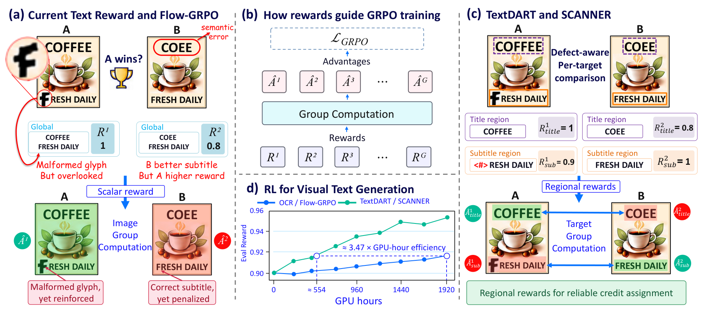
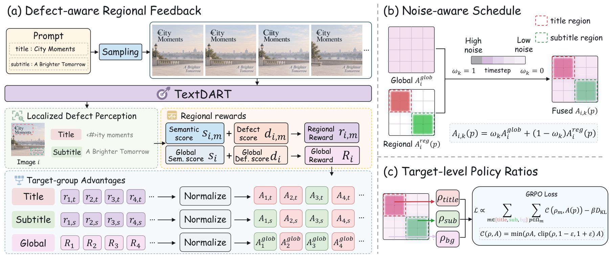
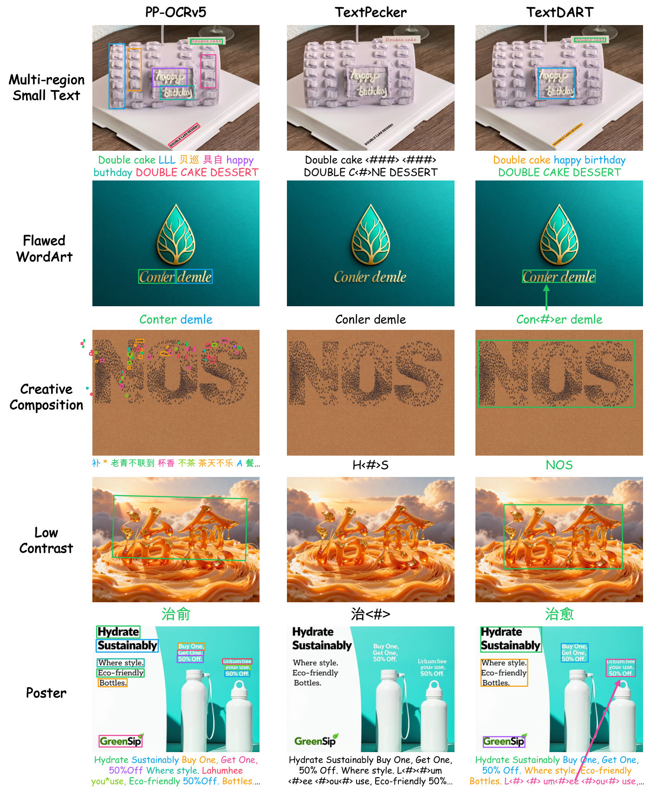
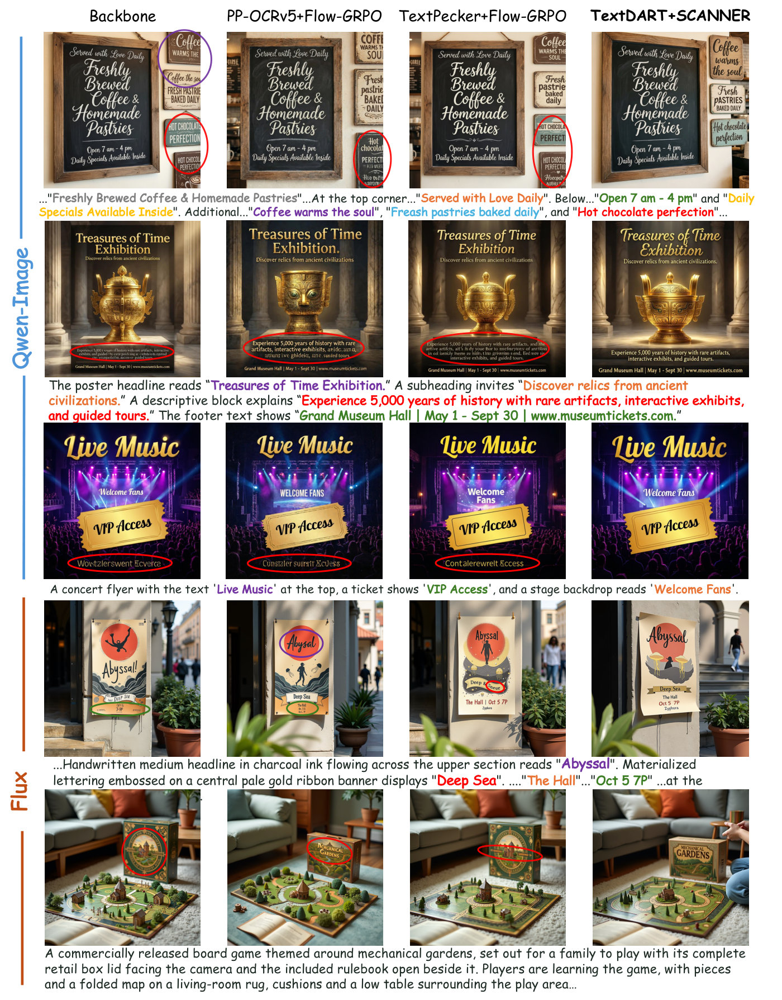

<h1 align="center"><code>TextDART 🎯 SCANNER 🔍</code></h1>

<h3 align="center"><i>Blame errant words, not the canvas.</i></h3>

<p align="center">
  <a href="https://arxiv.org/abs/2610.20794"></a>
  <a href="https://sujiehu.github.io/textdart-scanner/"></a>
  <a href="https://huggingface.co/SujieHu/TextDART-8B-Qwen3VL"></a>
  <a href="https://huggingface.co/datasets/SujieHu/TextDART-123K"></a>
  <a href="https://huggingface.co/datasets/SujieHu/PolyText-Bench"></a>
  <a href="LICENSE"></a>
</p>

This is the official implementation of the paper:

> **Blame Errant Words, Not the Canvas: Defect-Aware Spatial Credit Assignment for Visual Text Generation** <br>
> [Sujie Hu](https://scholar.google.com/citations?user=8YJvY9cAAAAJ)<sup>1,6</sup>, [Huaisong Zhang](https://scholar.google.com/citations?user=YZ-Nj2UAAAAJ)<sup>2,6</sup>, Pujing Yang<sup>3,6</sup>, [Qian Wang](https://akaneqwq.github.io)<sup>4,6</sup>, [Xiaomin Li](https://scholar.google.com/citations?user=o7BfVQkAAAAJ)<sup>5,6</sup>, Xinhang Leng<sup>6,†</sup>, Chen Li<sup>6</sup>, Jing Lyu<sup>6</sup>, Xiu Li<sup>2</sup>, [Ling Pan](https://ling-pan.github.io/)<sup>1,*</sup> <br>
> <sup>1</sup>The Hong Kong University of Science and Technology &nbsp; <sup>2</sup>Tsinghua University &nbsp; <sup>3</sup>Zhejiang University &nbsp; <sup>4</sup>Peking University &nbsp; <sup>5</sup>Dalian University of Technology &nbsp; <sup>6</sup>Weixin, Tencent <br>
> <sup>†</sup>Project lead &nbsp; <sup>\*</sup>Corresponding author

## 🔥 News
- **[2026/10/27]** Code, the TextDART-8B checkpoint, the TextDART-123K dataset and PolyText-Bench have been released. 🚀
- **[2026/10/14]** Paper released on arXiv. 🎉


<p align="center">
  
</p>

Detailed interactive demo is on the [project page](https://sujiehu.github.io/textdart-scanner/#demo).

## 📕 Table of Contents

- [Overview](#overview)
- [Recognition Results](#recognition-results)
- [Qualitative Results](#qualitative-results)
- [Quantitative Results](#quantitative-results)
- [Repository Layout](#repository-layout)
- [Part I: Reward Model (TextDART)](#part-i-reward-model-textdart)
- [Part II: Generative-Model RL (SCANNER)](#part-ii-generative-model-rl-scanner)
- [Evaluation](#evaluation)
- [Acknowledgements](#acknowledgements)
- [Citation](#citation)

<a id="overview"></a>

# ✨ Overview

<p align="center">
  
</p>

Reinforcement learning has improved visual text generation, but generated images still contain wrong words and malformed glyphs. Two coupled problems cause this. First, recognition-based rewards tend to overlook visible glyph defects. Second, a single whole-image score hides how unevenly the individual text regions are rendered. Our principle is to **blame errant words, not the canvas**: keep the quality differences between regions intact, from evaluation all the way to policy optimization.

- 🎯 **TextDART** (**D**efect-**A**ware **R**egion-**T**argeted rewards) localizes every text region as a quadrilateral and transcribes it, marking malformed glyphs with `<#>`/`<###>`/`<#####>` tokens. Each region then gets its own semantic-correctness and glyph-quality scores.
- 🔍 **SCANNER** (**S**patial **C**redit **A**ssig**N**ment with **N**ois**E**-awa**R**eness) turns these regional judgments into spatially differentiated policy feedback, in three steps:
  - It normalizes each text target's reward across the sampled images of a prompt (target-group advantages) and projects the resulting advantages onto that target's latent tokens.
  - It blends the global and regional advantages along the denoising trajectory, so feedback moves from global guidance at high noise to local feedback at low noise.
  - It pools policy ratios over each target's token support, so regional differences survive the optimization step.

<p align="center">
  
</p>

<a id="recognition-results"></a>

# 🔎 Recognition Results

PP-OCRv5, TextPecker and TextDART on five challenging scenes. TextDART localizes every text region and marks malformed glyphs with `<#>`/`<###>`/`<#####>`. Interactive overlays are on the [project page](https://sujiehu.github.io/textdart-scanner/#recognition).

<p align="center">
  
</p>

<a id="qualitative-results"></a>

# 🖼 Qualitative Results

The backbone, PP-OCRv5 + Flow-GRPO, TextPecker + Flow-GRPO and TextDART + SCANNER, on Qwen-Image-2512 (top) and FLUX.1-dev (bottom). Circles highlight rendering errors.

<p align="center">
  
</p>

<a id="quantitative-results"></a>

# 📊 Quantitative Results

Visual text generation across five benchmarks: English results for FLUX.1-dev, and English and Chinese results for Qwen-Image-2512. ↑ Higher is better. ↓ Lower is better. Bold is the best within each backbone and language. “—” denotes no reward / no RL, or an unsupported metric.

<details open>
<summary><b>FLUX.1-dev · English</b></summary>

<table>
  <thead>
    <tr>
      <th colspan="2">Training</th>
      <th>LongText-Bench</th>
      <th colspan="4">OneIG-Bench</th>
      <th colspan="2">CVTG-2K</th>
      <th colspan="2">GenTextEval</th>
      <th colspan="3">PolyText-Bench</th>
    </tr>
    <tr>
      <th>Reward</th><th>RL algorithm</th>
      <th>TextScore ↑</th>
      <th>TextScore ↑</th><th>ED ↓</th><th>CR ↑</th><th>WAC ↑</th>
      <th>WordAcc ↑</th><th>NED ↑</th>
      <th>Qua ↑</th><th>Sem ↑</th>
      <th>CS ↑</th><th>CG ↑</th><th>OG ↑</th>
    </tr>
  </thead>
  <tbody>
    <tr><td>—</td><td>—</td><td>0.620</td><td>0.543</td><td>85.31</td><td>0.138</td><td>0.379</td><td>0.503</td><td>0.694</td><td>0.661</td><td>0.352</td><td>0.426</td><td>0.464</td><td>0.281</td></tr>
    <tr><td>OCRv5</td><td>Flow-GRPO</td><td>0.769</td><td>0.751</td><td>64.55</td><td>0.220</td><td>0.506</td><td>0.686</td><td>0.818</td><td>0.838</td><td>0.589</td><td>0.703</td><td>0.726</td><td>0.365</td></tr>
    <tr><td>TextPecker</td><td>Flow-GRPO</td><td>0.801</td><td>0.770</td><td>63.19</td><td>0.221</td><td>0.533</td><td>0.772</td><td>0.879</td><td>0.836</td><td>0.582</td><td>0.789</td><td>0.809</td><td>0.405</td></tr>
    <tr><td><b>TextDART</b></td><td><b>SCANNER</b></td><td><b>0.827</b></td><td><b>0.858</b></td><td><b>51.06</b></td><td><b>0.309</b></td><td><b>0.598</b></td><td><b>0.834</b></td><td><b>0.914</b></td><td><b>0.839</b></td><td><b>0.613</b></td><td><b>0.882</b></td><td><b>0.905</b></td><td><b>0.653</b></td></tr>
  </tbody>
</table>

</details>

<details open>
<summary><b>Qwen-Image-2512 · English</b></summary>

<table>
  <thead>
    <tr>
      <th colspan="2">Training</th>
      <th>LongText-Bench</th>
      <th colspan="4">OneIG-Bench</th>
      <th colspan="2">CVTG-2K</th>
      <th colspan="2">GenTextEval</th>
      <th colspan="3">PolyText-Bench</th>
    </tr>
    <tr>
      <th>Reward</th><th>RL algorithm</th>
      <th>TextScore ↑</th>
      <th>TextScore ↑</th><th>ED ↓</th><th>CR ↑</th><th>WAC ↑</th>
      <th>WordAcc ↑</th><th>NED ↑</th>
      <th>Qua ↑</th><th>Sem ↑</th>
      <th>CS ↑</th><th>CG ↑</th><th>OG ↑</th>
    </tr>
  </thead>
  <tbody>
    <tr><td>—</td><td>—</td><td>0.952</td><td>0.986</td><td>24.54</td><td>0.461</td><td>0.895</td><td>0.844</td><td>0.922</td><td>0.944</td><td>0.787</td><td>0.887</td><td>0.899</td><td>0.252</td></tr>
    <tr><td>OCRv5</td><td>Flow-GRPO</td><td>0.947</td><td>0.989</td><td>19.58</td><td>0.509</td><td>0.890</td><td>0.832</td><td>0.914</td><td>0.946</td><td>0.795</td><td>0.876</td><td>0.876</td><td>0.273</td></tr>
    <tr><td>TextPecker</td><td>Flow-GRPO</td><td>0.960</td><td>0.988</td><td>22.14</td><td>0.484</td><td>0.891</td><td>0.870</td><td>0.936</td><td>0.956</td><td>0.801</td><td>0.908</td><td>0.918</td><td>0.269</td></tr>
    <tr><td><b>TextDART</b></td><td><b>SCANNER</b></td><td><b>0.972</b></td><td><b>0.995</b></td><td><b>13.44</b></td><td><b>0.585</b></td><td><b>0.919</b></td><td><b>0.878</b></td><td><b>0.939</b></td><td><b>0.970</b></td><td><b>0.844</b></td><td><b>0.953</b></td><td><b>0.970</b></td><td><b>0.496</b></td></tr>
  </tbody>
</table>

</details>

<details open>
<summary><b>Qwen-Image-2512 · Chinese</b></summary>

<table>
  <thead>
    <tr>
      <th colspan="2">Training</th>
      <th>LongText-Bench</th>
      <th colspan="4">OneIG-Bench</th>
      <th colspan="2">CVTG-2K</th>
      <th colspan="2">GenTextEval</th>
      <th colspan="3">PolyText-Bench</th>
    </tr>
    <tr>
      <th>Reward</th><th>RL algorithm</th>
      <th>TextScore ↑</th>
      <th>TextScore ↑</th><th>ED ↓</th><th>CR ↑</th><th>WAC ↑</th>
      <th>WordAcc ↑</th><th>NED ↑</th>
      <th>Qua ↑</th><th>Sem ↑</th>
      <th>CS ↑</th><th>CG ↑</th><th>OG ↑</th>
    </tr>
  </thead>
  <tbody>
    <tr><td>—</td><td>—</td><td>0.966</td><td>0.983</td><td>13.06</td><td>0.554</td><td>0.851</td><td>—</td><td>—</td><td>0.955</td><td>0.853</td><td>0.931</td><td>0.945</td><td>0.198</td></tr>
    <tr><td>OCRv5</td><td>Flow-GRPO</td><td>0.965</td><td>0.986</td><td>10.88</td><td>0.584</td><td>0.850</td><td>—</td><td>—</td><td>0.959</td><td>0.855</td><td>0.931</td><td>0.935</td><td>0.224</td></tr>
    <tr><td>TextPecker</td><td>Flow-GRPO</td><td>0.974</td><td>0.985</td><td>11.83</td><td>0.574</td><td>0.853</td><td>—</td><td>—</td><td>0.962</td><td>0.866</td><td>0.937</td><td>0.945</td><td>0.190</td></tr>
    <tr><td><b>TextDART</b></td><td><b>SCANNER</b></td><td><b>0.980</b></td><td><b>0.992</b></td><td><b>8.56</b></td><td><b>0.691</b></td><td><b>0.856</b></td><td>—</td><td>—</td><td><b>0.975</b></td><td><b>0.892</b></td><td><b>0.956</b></td><td><b>0.970</b></td><td><b>0.403</b></td></tr>
  </tbody>
</table>

</details>

<a id="repository-layout"></a>

# 🗂 Repository Layout

```
TextDART_SCANNER/
├── TextDART/                 # Part I: reward-model training, serving and demo (ms-swift + vLLM)
├── src/                      # Part II: RL framework with the SCANNER trainer
├── examples/grpo/lora/       # SCANNER configs for FLUX.1-dev and Qwen-Image-2512
├── multinode_examples/       # 4-node x 8-GPU launchers for those configs
├── dataset/                  # RL prompts with per-prompt target text lists
├── config/                   # accelerate / DeepSpeed configs
└── eval/                     # five-benchmark evaluation
```

The two parts are connected by a single interface: the TextDART model from Part I is deployed as an OpenAI-compatible server, and the `textdart` reward in Part II queries it during RL.

<a id="part-i-reward-model-textdart"></a>

# 🎯 Part I: Reward Model (TextDART)

| Resource | Hugging Face |
| --- | --- |
| Model | [SujieHu/TextDART-8B-Qwen3VL](https://huggingface.co/SujieHu/TextDART-8B-Qwen3VL) |
| Training data | [SujieHu/TextDART-123K](https://huggingface.co/datasets/SujieHu/TextDART-123K) |
| Base model | [Qwen/Qwen3-VL-8B-Instruct](https://huggingface.co/Qwen/Qwen3-VL-8B-Instruct) |

TextDART receives only the image and answers with every text region it finds:

```json
{"regions": [{"quad": [x1, y1, x2, y2, x3, y3, x4, y4], "recognized_text": "recognized text"}]}
```

Quads are on a 0-1000 grid normalized to the image size. `<#>`, `<###>` and `<#####>` mark a malformed character, word and text block.

## 1. Environment

Start from the `TextDART_SCANNER` project root. Run the remaining commands in
Part I from `TextDART/train`.

```bash
cd TextDART/train
conda create -n TextDART python=3.11 -y
conda activate TextDART
bash install_all.sh
```

<a id="serve-the-released-model"></a>

## 2. Serve the model and run the demo

```bash
# bash deploy_server.sh [MODEL] [PORT] [GPUS]; each listed GPU runs a full replica
bash deploy_server.sh SujieHu/TextDART-8B-Qwen3VL 1925 0,1,2,3,4,5,6,7

# in another shell, activate TextDART and enter TextDART/train before running the demo
python infer_demo.py --server-url http://127.0.0.1:1925
```

`127.0.0.1` is only for a client on the same machine as the server. If the server runs on another machine, replace it with that machine's IP. For example the machine IP is `10.0.0.1`, then the server address should be `http://10.0.0.1:1925`.

The demo writes `TextDART/demo_results/results.json` and an annotated `<image>_vis.png` per image.

## 3. Train TextDART

The SFT launcher requires FlashAttention and a CUDA development toolkit with `nvcc`.
See the [training guide](TextDART/train/README.md) for installation and dataset preparation.

```bash
INSTALL_FLASH_ATTN=1 bash install_all.sh
bash ../scripts/download_dataset.sh     # SujieHu/TextDART-123K -> TextDART/data/TextDART-123K
bash prepare_dataset.sh                 # parquet -> ms-swift cached dataset (CPU only)
# 4 nodes x 8 GPUs, run on every node
NNODES=4 NODE_RANK=<0..3> MASTER_ADDR=<node0 ip> MASTER_PORT=29500 bash train_textdart_qwen3vl.sh
```

See [`TextDART/train/README.md`](TextDART/train/README.md) for multi-machine dataset preparation and all options.

<a id="part-ii-generative-model-rl-scanner"></a>

# 🚀 Part II: Generative-Model RL (SCANNER)

## 1. Installation

Run the following commands from the project root (`TextDART_SCANNER`):

```bash
conda create -n scanner python=3.12 -y
conda activate scanner
pip install -c constraints-scanner.txt -e ".[deepspeed,wandb]"
pip check
```

## 2. Deploy the reward server

The RL configs talk to a TextDART OpenAI-compatible server (start it with `TextDART/train/deploy_server.sh`; see [Part I.2](#serve-the-released-model)). Several servers can be listed; ranks are spread across them. Replace the `<TODO: TEXTDART_SERVER_HOST>` placeholders in the config you plan to run.

## 3. Train

| Backbone | Config | 4-node launcher |
| --- | --- | --- |
| [FLUX.1-dev](https://huggingface.co/black-forest-labs/FLUX.1-dev) | [`examples/grpo/lora/flux1/textdart_scanner.yaml`](examples/grpo/lora/flux1/textdart_scanner.yaml) | [`multinode_examples/grpo/flux1/textdart_scanner_4nodes.sh`](multinode_examples/grpo/flux1/textdart_scanner_4nodes.sh) |
| [Qwen-Image-2512](https://huggingface.co/Qwen/Qwen-Image-2512) | [`examples/grpo/lora/qwen_image_2512/textdart_scanner.yaml`](examples/grpo/lora/qwen_image_2512/textdart_scanner.yaml) | [`multinode_examples/grpo/qwenimage2512/textdart_scanner_4nodes.sh`](multinode_examples/grpo/qwenimage2512/textdart_scanner_4nodes.sh) |

Both configs were tuned on 4 nodes x 8 GPUs.

<a id="evaluation"></a>

# 📊 Evaluation

The evaluation pipeline supports LongText, OneIG-Bench, CVTG-2K, GenTextEval
and [PolyText-Bench](https://huggingface.co/datasets/SujieHu/PolyText-Bench).
Follow the [evaluation guide](eval/README.md) to install the environments,
download benchmark tools and data, configure model paths, and start the scoring
servers.

After setup, run from the `TextDART_SCANNER` project root:

```bash
conda activate textdart_eval
cd eval
bash scripts/gen.sh              # generate images for every benchmark
bash scripts/eval_metrics.sh     # score (needs the TextPecker / TextDART servers)
bash scripts/cal_metrics.sh      # summary table -> eval/metric_summary.md
```

GenTextEval and PolyText-Bench are included in the repository. The setup
command `bash eval/setup_third_party.sh all` downloads official LongText,
OneIG-Bench and CVTG-2K tools at fixed commits.
The bundled PolyText-Bench workflow uses three entry points:
`generate.py` for image generation, `evaluate.py` for resumable TextDART
scoring, and `summarize.py` for the final CS/CG/OG report. The released
[TextDART checkpoint](https://huggingface.co/SujieHu/TextDART-8B-Qwen3VL)
can be downloaded directly from Hugging Face.

<a id="acknowledgements"></a>

# 🤗 Acknowledgements

This repository is built on the following repositories, and we thank their authors:

- [Flow-Factory](https://github.com/X-GenGroup/Flow-Factory): the RL framework that SCANNER extends.
- [TextPecker](https://github.com/CIawevy/TextPecker): the structural-anomaly marker scheme and text scoring that TextDART builds on, and the GenTextEval benchmark.

We also rely on [ms-swift](https://github.com/modelscope/ms-swift), [vLLM](https://github.com/vllm-project/vllm), [diffusers](https://github.com/huggingface/diffusers), [accelerate](https://github.com/huggingface/accelerate) and [peft](https://github.com/huggingface/peft). See [`THIRD_PARTY_NOTICES.md`](THIRD_PARTY_NOTICES.md) for bundled components, separately licensed datasets, and optional evaluation code downloaded from upstream.

<a id="citation"></a>

# 📝 Citation

If you find this work useful, please cite:

```bibtex
@article{hu2026textdartscanner,
  title={Blame Errant Words, Not the Canvas: Defect-Aware Spatial Credit Assignment for Visual Text Generation},
  author={Hu, Sujie and Zhang, Huaisong and Yang, Pujing and Wang, Qian and Li, Xiaomin and Leng, Xinhang and Li, Chen and Lyu, Jing and Li, Xiu and Pan, Ling},
  journal={arXiv preprint arXiv:2610.20794},
  year={2026}
}
```
